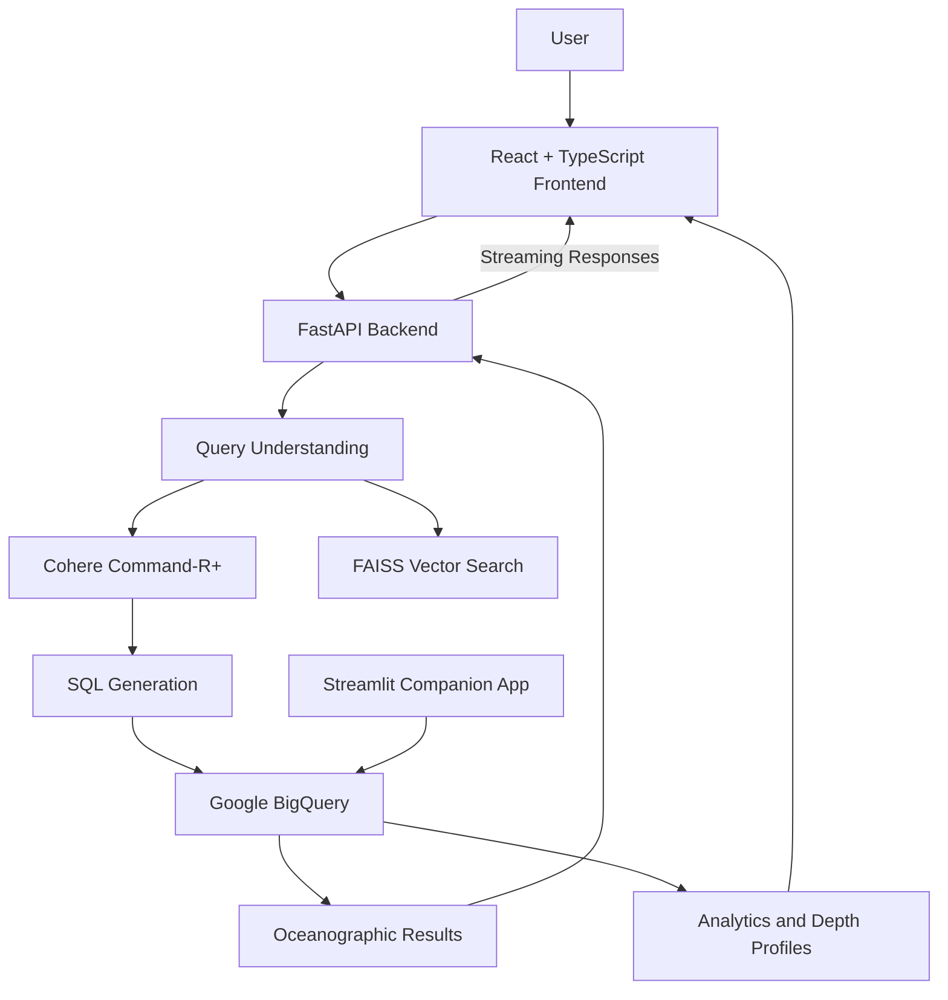

# 🌊 Neel Drishti 

### AI-Powered Oceanographic Intelligence Platform

**Making global ocean data accessible through artificial intelligence, real-time analytics, and interactive visualizations.**

---

## 📌 Overview

**Neel Drishti** is an AI-powered oceanographic analytics platform that simplifies access to global **ARGO float data**.

Traditional oceanographic datasets can be difficult to explore without specialized knowledge of scientific data formats, database queries, and ocean parameters. Neel Drishti bridges this gap by allowing users to interact with ocean data using natural language and intuitive visualizations.

The platform combines a **FastAPI backend**, **FAISS vector search**, **Cohere Command-R+**, and **Google Cloud BigQuery** to support conversational data exploration, analytical queries, and interactive oceanographic insights through a modern React-based interface.

Whether you're exploring ocean temperature, analyzing salinity profiles, or tracking ARGO floats, Neel Drishti provides a unified environment for ocean data discovery.

## ✨ Key Features

### 🤖 AI-Powered Ocean Chatbot
- Ask oceanographic questions using natural language.
- Explore ARGO data and oceanographic concepts.
- Support conversational data exploration using an LLM-powered backend.

### ⚡ Real-Time AI Responses
- Stream responses using Server-Sent Events (SSE).
- Deliver incremental results for a more responsive chat experience.

### 🧠 Natural Language to SQL
- Translate user questions into BigQuery SQL queries.
- Apply query constraints and filtering to support safer data exploration.
- Retrieve relevant oceanographic records from structured datasets.

### 🗺️ Interactive ARGO Float Map
- Explore float locations across global coordinates.
- Visualize float positions and reported operational states.
- Discover oceanographic observations geographically.

### 🌡️ Ocean Depth Profiling
- Analyze temperature, salinity, and pressure against depth.
- Explore profiles across the Atlantic, Pacific, and Indian Oceans.
- Present scientific measurements through interactive charts.

### 📊 Ocean Analytics Dashboard
- Explore key metrics and data previews.
- Monitor available oceanographic observations.
- Support data-driven exploration of ocean trends.

### 📈 Streamlit Companion Application
- Generate interactive scientific plots.
- Detect columns for plotting workflows.
- Export data as CSV for further analysis.

---

## 🛠️ Technology Stack

| Category | Technologies |
|---|---|
| Frontend | React, TypeScript, Vite, Tailwind CSS |
| UI & Visualization | Framer Motion, Recharts |
| Backend | Python, FastAPI, Uvicorn |
| AI & Language Models | Cohere Command-R+ |
| Retrieval & Semantic Search | FAISS, Sentence Transformers |
| Database & Analytics | Google Cloud BigQuery |
| Authentication | Firebase Authentication |
| Data Visualization | Streamlit, Plotly Express, Pandas |
| API Communication | REST APIs, Server-Sent Events |

---

## 🏗️ Architecture



*Conceptual architecture based on the documented technology stack. Actual component connections may vary with the implementation.*

---

## 📁 Project Structure

```text
NEEL-DRISTI-/
├── chatbot.py
├── streamlit_app.py
├── requirements.txt
├── .env.example
├── .gitignore
├── LICENSE
└── project/
    ├── package.json
    └── src/
        ├── pages/
        ├── components/
        └── firebase.ts
```

> **Note:** This is a simplified overview. The actual repository may contain additional modules and configuration files. Keep service-account credentials and local environment files out of Git.

---

## 🚀 Getting Started

Follow these steps to run Neel Drishti locally.

### Prerequisites

Make sure you have the following installed:

- [Python 3.10+](https://www.python.org/downloads/)
- [Node.js 18+](https://nodejs.org/)
- npm
- A Google Cloud project with BigQuery access
- A Cohere API key
- Firebase configuration, if required by the frontend

### 1. Clone the Repository

```bash
git clone https://github.com/bhavyasharma05/NEEL-DRISTI-.git
cd NEEL-DRISTI-
```

### 2. Configure the Backend

Create a Python virtual environment:

```bash
python -m venv .venv
```

Activate it on Windows:

```powershell
.\.venv\Scripts\Activate.ps1
```

Install the dependencies:

```bash
pip install -r requirements.txt
```

Create your local environment configuration:

```powershell
Copy-Item .env.example .env
```

Update `.env` with your own credentials:

```dotenv
COHERE_API_KEY=your_cohere_api_key
BQ_PROJECT_ID=your_google_cloud_project_id
BQ_DATASET_ID=argo
BQ_TABLE_NAME=argo_profiles
GOOGLE_APPLICATION_CREDENTIALS=floatchat-key.json
```

Configure Google Cloud authentication using your own authorized service-account credentials or Application Default Credentials. Ensure the credential path matches your local setup.

### 3. Configure the Frontend

Navigate to the frontend directory:

```bash
cd project
npm install
```

Configure any required frontend environment variables using the variable names expected by the application.

### 4. Run the Backend

From the repository root, start FastAPI:

```bash
uvicorn chatbot:app --host 127.0.0.1 --port 8000 --reload
```

Available local endpoints:

| Resource | URL |
|---|---|
| Backend | http://localhost:8000 |
| API Documentation | http://localhost:8000/docs |

### 5. Run the Frontend

From the `project/` directory:

```bash
npm run dev
```

Open the local development URL printed by Vite, typically:

http://localhost:5173

### 6. Run the Streamlit Companion App

From the repository root:

```bash
streamlit run streamlit_app.py
```

The application is typically available at:

http://localhost:8501

---

## 🔌 API Reference

The following endpoints are documented for the backend.

| Method | Endpoint | Description |
|---|---|---|
| `GET` | `/ready` | Check server and vector-index readiness |
| `POST` | `/ask` | Submit a conversational question |
| `GET` | `/ask_with_data` | Retrieve query results for data exploration |
| `POST` | `/insights/temperature` | Analyze temperature-depth profiles |
| `POST` | `/insights/salinity` | Analyze salinity-depth profiles |
| `POST` | `/insights/pressure` | Analyze pressure-depth profiles |

The `/ask` endpoint supports streaming when configured by the application. Check the backend implementation for exact request parameters, response formats, and authentication requirements.

---

## 👥 Team

| Team Member | Contribution |
|---|---|
| **Bhavya Kumar Sharma** | Backend Development |
| **Nishchal Kumar** | Database Engineering |


---

## 🔐 Security

Security is essential when working with AI services and cloud infrastructure.

- Never commit API keys, passwords, or service-account JSON files.
- Keep `.env` local and use `.env.example` for configuration templates.
- Restrict Google Cloud service-account permissions to the resources required by the application.
- Rotate credentials immediately if they are accidentally exposed.
- Avoid placing private datasets or sensitive configuration in public repositories.

---

## 🗺️ Future Enhancements

Potential areas for further development include:

- Advanced oceanographic trend analysis.
- Expanded ARGO float exploration and filtering.
- More scientific visualization options.
- Improved conversational context and query interpretation.
- Enhanced data export and research workflows.

---

## 📄 License

See the [`LICENSE`](LICENSE) file for licensing terms.

---

<p align="center">
  <strong>Neel Drishti — Bringing Ocean Data Within Everyone's Reach 🌊</strong>
  <br>
  Built to make oceanographic data easier to explore, understand, and analyze.
</p>
